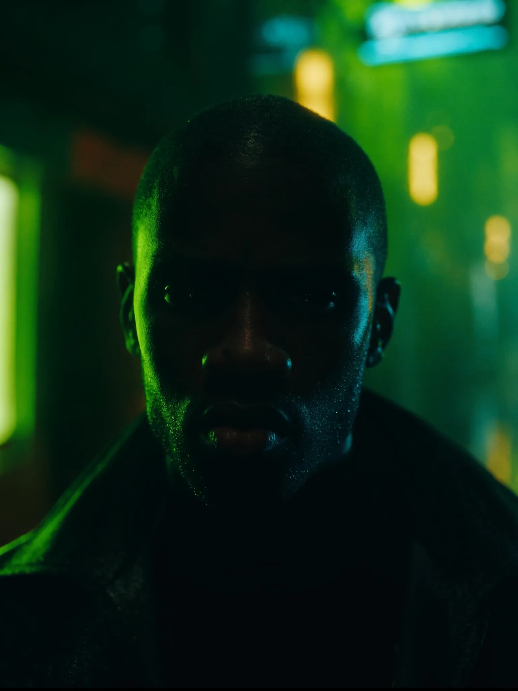

# Hixfield

The Higgsfield create experience as a web app you can clone: camera-controlled video, Soul images, consistent characters and talking avatars, all on the official API with your own key.


→ Camera-controlled video with 50+ live motion presets, up to 2 stacked motions, and start/end frames \
→ Soul images with 80+ live style presets and 4x batches \
→ Soul ID character consistency: train once, render the same person in any scene \
→ Speak talking avatars with automatic WAV conversion \
→ A persistent local library with honest credit costs on every job \
→ A schema-driven playground for the wider model catalog: Kling, Veo, Wan, Sora 2, Seedance, Nano Banana and more \
→ 100% open source. MIT license.

|  |  |  |
|:--:|:--:|:--:|
| Y2K digicam | Neon noir | Quiet luxury |

## Quickstart

You need Docker, or Bun 1.2+ (Node 20+ also works) plus ffmpeg for Speak audio conversion.

```sh
git clone https://github.com/Mukhsin0508/hixfield.git
cd hixfield
cp .env.example .env
docker compose up
```

Create an API key pair at [cloud.higgsfield.ai](https://cloud.higgsfield.ai) and paste `HF_API_KEY_ID` and `HF_API_KEY_SECRET` into `.env` before starting. Then open [http://localhost:3000](http://localhost:3000).

Prefer bare metal?

```sh
bun install && bun dev
```

Two env vars, one command. The motion gallery renders live within two minutes.

## How it works

Hixfield is a server-side proxy in front of `platform.higgsfield.ai`. Your key pair never reaches the browser; every upstream call carries `Authorization: Key id:secret` from the server. Jobs follow the API's submit-then-poll pattern, checked every 2 seconds. When a job completes, its output downloads to `./data` immediately, because Higgsfield's asset URLs expire in about seven days; the library owns its files. A local queue keeps you under your plan's concurrency cap, since the API answers overflow with a plain HTTP 400 and no rate-limit headers. Credits are charged only on completed jobs; failed and nsfw-flagged jobs refund automatically.

## Pages

| Route | What it is |
|---|---|
| `/` | The landing page |
| `/create/video` | DoP image-to-video: browse the motion gallery, stack two moves, set frames |
| `/create/image` | Soul text-to-image with the live style catalog and 4x batches |
| `/characters` | Train and manage Soul IDs for character consistency |
| `/speak` | Talking avatars from a portrait and an audio track |
| `/library` | Every job with its parameters, credit cost, and files on your disk |
| `/playground` | Schema-driven forms for the wider model catalog |

## Configuration

| Variable | Default | What it does |
|---|---|---|
| `HF_API_KEY_ID` | required | Key id from cloud.higgsfield.ai |
| `HF_API_KEY_SECRET` | required | Key secret. Server-side only, never sent to the browser |
| `HF_MAX_CONCURRENCY` | `3` | Local queue cap; the API rejects overflow with HTTP 400 |
| `DATA_DIR` | `./data` | Where the job database and downloaded assets live |
| `NEXT_PUBLIC_GITHUB_REPO` | `Mukhsin0508/hixfield` | Repo shown on the landing page |

## What this is, what this isn't

This is a self-hosted web app for Higgsfield's official public API. You bring the key pair, your account pays the credits, and only for jobs that complete.

It is not affiliated with Higgsfield AI, and it is not their private stack. Upscale, the VFX library, Cinema Studio and inpainting are not on the public API, so you won't find them here. The playground's model catalog (`src/data/models.json`) is generated from the official OpenAPI spec, which ships in this repo at `docs/higgsfield-openapi.json`; every route and parameter matches the spec, and Speak rides the SDK-documented v1 endpoint.

## Media provenance

Every image and clip in this repo was generated with Higgsfield: Soul stills, then image-to-video for the loops. Nothing is taken from their site or brand assets.

## Contributing

Issues and pull requests are welcome; keep changes honest about what the public API actually supports.

MIT license.
